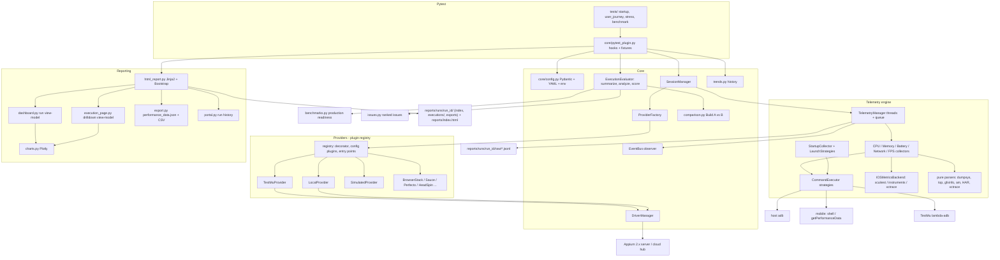

# Architecture

## 1. Architecture diagram



### Test lifecycle

```mermaid
sequenceDiagram
    participant P as pytest
    participant PL as pytest_plugin
    participant SM as SessionManager
    participant PR as DeviceProvider
    participant TM as TelemetryManager
    participant R as HtmlReportGenerator

    P->>PL: pytest_sessionstart
    PL->>PL: load_config, run_id, EventBus
    P->>PL: pytest_runtest_setup (perf marker)
    PL->>SM: open(test)
    SM->>PR: validate() / create_driver()
    P->>PL: pytest_runtest_call
    PL->>SM: start_telemetry
    SM->>PR: start_telemetry(sink)
    PR->>TM: start collector threads
    Note over P,TM: test body runs; collectors sample in parallel
    PL->>SM: stop_telemetry
    P->>PL: pytest_runtest_teardown
    PL->>SM: close(status)
    SM->>PR: final / failure screenshot, mark_session_status, quit
    SM->>PR: collect_post_session_metrics (cloud profiling, HAR)
    PL->>PL: evaluate: summarize + analyze + score + benchmarks + issues, save JSON
    P->>PL: pytest_sessionfinish
    PL->>PL: aggregate run, readiness, compare baseline, append trend
    PL->>R: generate(run, trend)
    R-->>P: runs/run_id/index.html + executions/*.html + exports, reports/index.html
```

### Telemetry threading model

```text
collector thread (cpu)     ─┐
collector thread (memory)  ─┤
collector thread (battery) ─┼─► queue.Queue ─► writer thread ─► TelemetryData (lock-protected)
collector thread (network) ─┤                             ├──► reports/runs/<run_id>/raw/<test>.jsonl
collector thread (fps)     ─┘                             └──► EventBus(SAMPLE_COLLECTED)
test thread: PerfRecorder.step() / StartupCollector ──► TelemetryManager.record() ──► same queue
```

* One daemon thread per collector, cadence `telemetry.sampling_interval_sec`.
* A single writer owns the JSONL file, so writes never interleave.
* Failures are isolated per collector (disabled after `max_consecutive_errors` or on
  `CollectorUnavailableError`); the test and other collectors carry on.
* Executors serialise Appium calls with a lock because several collectors share one driver.
* `astart()` / `astop()` / `async with` wrap the manager for asyncio code.

### Slow-step root cause

```text
PerfRecorder.step("home")
  ├─ DriverTracer      wraps driver.execute (all Selenium / Appium and WebElement commands);
  │                    records only the step's thread, attributes each command to the calling
  │                    project method chain (HomePage.wait_loaded > BasePage.find) + locator
  ├─ CrashMonitor      reads the device log after the step ─► AppLogAnalyzer ─► AppSignal[]
  └─ StepTiming(calls=[DriverCall], app_signals=[AppSignal])
SessionManager.close ─► HAR ─► NetworkRequest(operation, server_ms, phases, trace_id)
ExecutionEvaluator   ─► attribution.step_breakdowns(steps, requests)
                          requests overlapping the step window (timestamps), busy-time union
                          primary: blocking app signal >= 25% | API busy >= 40% | test method
                     ─► issues (cause), execution page (#why-step-n, #operations), export
```

The tracer is per-thread and guards nested calls, so collector threads that share the
driver are never counted, and wall times (command time plus the test code before it) add
up to the step duration. Driver tracing and app-log analysis are off with
`attribution.trace_driver_commands` / `attribution.app_log_signals`.

## 2. Folder structure

```text
mobile-perf-framework/
├── config/
│   ├── framework.yaml          providers, telemetry, startup, endurance, scoring, comparison, reporting
│   ├── devices.yaml            logical device profiles + per-provider overrides
│   └── app.yaml                app identifiers, builds A/B, test data, YAML locators
├── core/
│   ├── config.py               Pydantic config models, YAML loader, ${ENV:-default} interpolation
│   ├── provider_factory.py     Factory: name -> DeviceProvider instance
│   ├── driver_manager.py       Appium 2.x driver creation (UiAutomator2 / XCUITest options, retries)
│   ├── session_manager.py      provider -> driver -> telemetry -> TestExecution lifecycle
│   ├── events.py               thread-safe EventBus (Observer)
│   ├── recorder.py             PerfRecorder: step timings / iteration markers
│   ├── tracing.py              DriverTracer: times each Appium command per page-object method
│   ├── attribution.py          slow-step root cause (app / backend API / test code), operation stats
│   ├── screenshots.py          step-by-step screenshots (numbered, JPEG-downscaled)
│   ├── analysis.py             KPI summary, leak / CPU-growth / degradation detection
│   ├── benchmarks.py           production benchmarks (Android vitals, SLOs) + readiness
│   ├── issues.py               ranked issues with drilldown anchors
│   ├── scoring.py              weighted 0-100 score + rating
│   ├── comparison.py           Build A vs Build B (+ CLI)
│   ├── trends.py               run-over-run history
│   └── pytest_plugin.py        hooks, CLI options, fixtures
├── providers/
│   ├── base.py                 DeviceProvider ABC + AppiumDeviceProvider
│   ├── registry.py             @register_provider, config plugins, entry points
│   ├── testmu_provider.py      TestMu AI (formerly LambdaTest) real-device cloud
│   ├── testmu_api.py           TestMu REST client (upload, session, app metrics, network log)
│   ├── local_provider.py       local Appium + adb / xctrace
│   └── simulated_provider.py   realistic fake device (CI smoke / demos)
├── telemetry/
│   ├── telemetry_manager.py    threaded collection engine
│   ├── base_collector.py       BaseCollector, CollectorContext, collector registry
│   ├── executors.py            AdbExecutor, AppiumShellExecutor, TestMuAdbExecutor
│   ├── android_helpers.py      pid resolution
│   ├── cpu_collector.py        top / getPerformanceData(cpuinfo) / iOS backend
│   ├── memory_collector.py     dumpsys meminfo / memoryinfo / iOS backend
│   ├── battery_collector.py    dumpsys battery + batterystats attribution
│   ├── network_collector.py    /proc/<pid>/net/dev / networkinfo + HAR
│   ├── fps_collector.py        dumpsys gfxinfo windows (FPS, jank, frame drops)
│   ├── startup_collector.py    cold / warm / hot launch strategies
│   ├── parsers/android.py      pure parsers for Android shell output
│   ├── parsers/har.py          HAR -> NetworkRequest (operation, server time, phases, trace id)
│   ├── parsers/app_log.py      logcat -> AppSignal (Displayed, StrictMode, Looper, Choreographer, Davey)
│   ├── crash_monitor.py        crash / ANR detection after each step (also feeds app_log)
│   └── ios/                    backend.py, xcuitest_backend.py, instruments_backend.py,
│                               xctrace_backend.py, xctrace_parser.py
├── models/
│   ├── telemetry_model.py      samples (discriminated union), TelemetryData, TelemetrySummary
│   ├── execution_model.py      DeviceInfo, AppInfo, TestExecution, RunSummary
│   ├── report_model.py         PerformanceScore, AnalysisFinding, Issue, BenchmarkResult, Readiness, ...
│   └── performance_data.py     versioned performance_data.json schema
├── reporting/
│   ├── charts.py               Plotly chart builders (incl. per-test step/metric timeline)
│   ├── dashboard.py            run report view-model
│   ├── execution_page.py       per-test drilldown view-model
│   ├── export.py               performance_data.json, JSON Schema, CSV
│   ├── portal.py               run history index
│   ├── links.py                execution slugs and deep links
│   ├── html_report.py          writes the run folder, prunes old runs, renders the portal
│   └── templates/              base, run, execution (drilldown), portal (Bootstrap 5)
├── pages/                      YAML-driven page objects (login, search, checkout, profile)
├── tests/
│   ├── startup/                startup benchmark
│   ├── user_journey/           login -> search -> checkout -> profile
│   ├── stress/                 endurance 50 / 100 / 500 iterations
│   ├── benchmark/              Build A vs Build B
│   └── unit/                   framework unit tests + dumpsys fixtures
├── utils/                      adb_utils.py, ios_utils.py, logger.py, retry.py, formatting.py
├── ci/                         azure-pipelines.yml, Jenkinsfile, publish_summary.py
├── .github/workflows/          mobile-perf.yml
├── docs/                       ARCHITECTURE.md, PROVIDER_EXTENSION_GUIDE.md
├── conftest.py, pytest.ini, pyproject.toml, requirements.txt, requirements-dev.txt, .env.example
└── reports/                    generated: index.html (all runs), runs/<run_id>/, history/, latest copies
```

## 3. UML class diagram

```mermaid
classDiagram
    direction LR

    class DeviceProvider {
        <<abstract>>
        +name: str
        +config: FrameworkConfig
        +device: DeviceProfile
        +driver
        +create_driver()*
        +start_telemetry(sink_path)*
        +stop_telemetry() TelemetryData*
        +get_metrics() TelemetryData*
        +validate()
        +build_capabilities() dict
        +get_command_executor() CommandExecutor
        +get_ios_backend() IOSMetricsBackend
        +get_launch_strategy() LaunchStrategy
        +record(sample)
        +mark_session_status(passed, reason)
        +take_screenshot(path)
        +device_info() DeviceInfo
        +session_metadata() dict
        +collect_post_session_metrics() TelemetryData
        +quit()
    }
    class AppiumDeviceProvider {
        +telemetry: TelemetryManager
        +load_network_log() dict
        +stamp(source) dict
    }
    class TestMuProvider {
        +api: TestMuApiClient
        +hub_url() str
        +resolve_app() str
    }
    class LocalProvider {
        +adb() AdbClient
    }
    class SimulatedProvider {
        +sim_device: SimulatedDevice
    }
    DeviceProvider <|-- AppiumDeviceProvider
    AppiumDeviceProvider <|-- TestMuProvider
    AppiumDeviceProvider <|-- LocalProvider
    AppiumDeviceProvider <|-- SimulatedProvider
    TestMuProvider --> TestMuApiClient

    class ProviderFactory {
        +create(name, device, platform, test_name, app_override) DeviceProvider
        +available() list
    }
    class ProviderRegistry {
        +register_provider(name, aliases)
        +get_provider_class(name)
        +load_plugins(modules)
    }
    ProviderFactory --> ProviderRegistry
    ProviderRegistry o-- DeviceProvider

    class DriverManager {
        +create(url, platform, caps) WebDriver
        +build_options(platform, caps)
    }
    TestMuProvider --> DriverManager
    LocalProvider --> DriverManager

    class SessionManager {
        +open(test_id, name, type) PerfSession
        +start_telemetry(session)
        +stop_telemetry(session) TelemetryData
        +close(session, status, error) TestExecution
    }
    class PerfSession {
        +test_id
        +provider: DeviceProvider
        +raw_path
        +label
    }
    SessionManager --> ProviderFactory
    SessionManager --> PerfSession
    PerfSession --> DeviceProvider

    class TelemetryManager {
        +collectors: list
        +start(sink_path)
        +stop() TelemetryData
        +snapshot() TelemetryData
        +record(sample)
        +astart()
        +astop()
    }
    class BaseCollector {
        <<abstract>>
        +kind: MetricKind
        +context: CollectorContext
        +on_start()
        +collect() list*
        +on_stop() list
    }
    class CPUCollector
    class MemoryCollector
    class BatteryCollector
    class NetworkCollector
    class FPSCollector
    BaseCollector <|-- CPUCollector
    BaseCollector <|-- MemoryCollector
    BaseCollector <|-- BatteryCollector
    BaseCollector <|-- NetworkCollector
    BaseCollector <|-- FPSCollector
    AppiumDeviceProvider --> TelemetryManager
    TelemetryManager o-- BaseCollector
    TelemetryManager --> EventBus

    class CollectorContext {
        +platform
        +app_id
        +executor: CommandExecutor
        +ios_backend: IOSMetricsBackend
        +har_loader
        +stamp(source) dict
    }
    BaseCollector --> CollectorContext

    class CommandExecutor {
        <<abstract>>
        +shell(command) str*
        +performance_data(package, type) list
    }
    class AdbExecutor
    class AppiumShellExecutor
    class TestMuAdbExecutor {
        +fallback: CommandExecutor
    }
    CommandExecutor <|-- AdbExecutor
    CommandExecutor <|-- AppiumShellExecutor
    CommandExecutor <|-- TestMuAdbExecutor
    CollectorContext --> CommandExecutor

    class IOSMetricsBackend {
        <<abstract>>
        +start_session()
        +stop_session() list
        +cpu_usage() float
        +memory_usage_mb() float
        +battery_level() float
        +fps() float
        +measure_launch(mode) float
    }
    class XCUITestMetricsBackend
    class InstrumentsBackend
    class XctraceBackend
    IOSMetricsBackend <|-- XCUITestMetricsBackend
    XCUITestMetricsBackend <|-- InstrumentsBackend
    IOSMetricsBackend <|-- XctraceBackend
    CollectorContext --> IOSMetricsBackend

    class StartupCollector {
        +measure(mode, iteration) StartupMetrics
        +benchmark(modes, iterations, warmup) dict
    }
    class LaunchStrategy {
        <<abstract>>
        +prepare(mode)*
        +launch(mode)* LaunchResult
        +measure(mode) LaunchResult
    }
    class AdbLaunchStrategy
    class DriverLaunchStrategy
    class IOSBackendLaunchStrategy
    class FallbackLaunchStrategy
    LaunchStrategy <|-- AdbLaunchStrategy
    LaunchStrategy <|-- DriverLaunchStrategy
    LaunchStrategy <|-- IOSBackendLaunchStrategy
    LaunchStrategy <|-- FallbackLaunchStrategy
    FallbackLaunchStrategy o-- LaunchStrategy
    StartupCollector --> LaunchStrategy

    class EventBus {
        +subscribe(type, handler)
        +publish(type, payload)
    }

    class ExecutionEvaluator {
        +evaluate(execution) TestExecution
    }
    class ScoringEngine {
        +score(summary) PerformanceScore
    }
    ExecutionEvaluator --> ScoringEngine

    class HtmlReportGenerator {
        +generate(run, trend) Path
        +write_metrics(run) Path
    }
    class DashboardBuilder {
        +build(run, trend) DashboardContext
    }
    HtmlReportGenerator --> DashboardBuilder
    DashboardBuilder ..> Charts

    class TelemetryData {
        +cpu
        +memory
        +battery
        +fps
        +network
        +requests
        +startup
        +steps
        +add(sample)
        +merge_missing(other)
    }
    class TestExecution {
        +test_id
        +status
        +device: DeviceInfo
        +app: AppInfo
        +telemetry: TelemetryData
        +summary: TelemetrySummary
        +score: PerformanceScore
        +findings
    }
    class RunSummary {
        +run_id
        +executions
        +score
        +metrics
        +comparisons
    }
    TestExecution --> TelemetryData
    RunSummary o-- TestExecution
```



## 4. Design patterns

| Pattern | Where |
| --- | --- |
| Factory | `ProviderFactory`, `create_collectors`, `create_ios_backend` |
| Strategy | `DeviceProvider`, `CommandExecutor`, `LaunchStrategy`, `IOSMetricsBackend` |
| Observer | `EventBus` (telemetry, test, session and report events) |
| Plugin architecture | `@register_provider` / `@register_collector` / `@register_ios_backend`, `framework.plugins`, `mobile_perf.providers` entry points |
| Template method | `BaseCollector` lifecycle (`on_start` / `collect` / `on_stop`), `LaunchStrategy.measure` |
| Chain of responsibility | `TestMuAdbExecutor` fallback and `FallbackLaunchStrategy` |

SOLID notes:

* **S**: parsers are pure, collectors only sample, the manager only schedules, and the
  scoring, analysis and reporting are separate modules.
* **O**: providers, collectors and iOS backends are added by registering new classes; core is unchanged.
* **L**: every provider honours the `DeviceProvider` contract, and the simulated provider runs the full suite.
* **I**: optional capabilities are hooks with safe defaults, not mandatory methods.
* **D**: collectors depend on `CommandExecutor` and `IOSMetricsBackend` abstractions, never on adb or a cloud SDK.

## 5. Metric sources

| Metric | Android (local) | Android (TestMu) | iOS |
| --- | --- | --- | --- |
| Startup | `am start -W` + logcat `Displayed` | Appium `terminate_app`/`activate_app` timing (`am` blocked on public devices) | `mobile: launchApp` timing / `devicectl` |
| Memory | `dumpsys meminfo` | `lambda-adb dumpsys meminfo` -> `getPerformanceData` -> app profiling API | Instruments / xctrace Activity Monitor |
| CPU | `top -b -n 1 -p` | `getPerformanceData(cpuinfo)` -> app profiling API | Instruments / xctrace |
| Battery | `dumpsys battery` + `batterystats` | `lambda-adb dumpsys battery` / `batteryinfo` | `mobile: batteryInfo` |
| FPS | `dumpsys gfxinfo <pkg> reset` | `lambda-adb dumpsys gfxinfo` -> app profiling API | xctrace (custom templates) |
| Network | `/proc/<pid>/net/dev` + HAR | `networkinfo` + session network log (HAR) | HAR / proxy |

Post-session data (TestMu app profiling, HAR) is merged only for metric kinds that live
collection did not capture, so the two sources are never double-counted.
